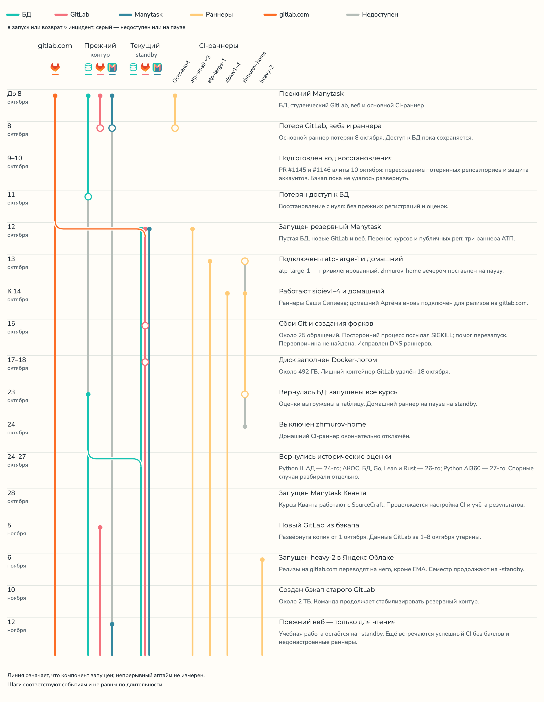

# Разбор инцидента с Manytask 8 октября 2026 года

**Период инцидента:** с 8 октября 2026 года. **Срез состояния:** 18 ноября 2026 года. **Статус:** учебная работа продолжается на резервной инфраструктуре. Прежняя БД доступна с 23 октября, новый инстанс GitLab из бэкапа — с 5 ноября; 12 ноября восстановлен прежний веб.

Manytask потерял доступ к прежнему студенческому GitLab, а затем к базе приложения. Быстро восстановить сервис из доступной резервной копии не удалось. Команда развернула новый GitLab и Manytask, пересоздала курсы и постепенно вернула сдачу решений и исторические оценки. Ключевая проблема — отсутствие проверенного способа восстановить всю учебную цепочку независимо от исходной площадки.

Manytask включает приложение с регистрацией и оценками, базу данных, GitLab или SourceCraft с репозиториями, CI и раннеры, а также передачу результатов в ЛМС. Отказ и восстановление этих компонентов происходили в разное время.

## Хронология событий

Все даты и время указаны по Москве.

| Дата | Что произошло |
|---|---|
| 8 октября, 02:27 | Появилось раннее сообщение о недоступности приложения в чате курса по Lean. Основной CI-раннер также был недоступен; причина не установлена. В течение дня команда разбирала недоступность студенческого GitLab и возможность восстановления из бэкапа от 1 октября. |
| 8–10 октября | Восстановление прежнего GitLab упиралось в ограничения облака по созданию ВМ, SSD-квоты и требования к диску. К 10 октября восстановить из бекапа не удалось. Преподаватели и сообщество публиковали временные копии заданий (публичных репозиториев) для локальной работы. |
| 9–10 октября | Подготовили изменения кода Manytask для восстановления: [PR #1145](https://github.com/manytask/manytask/pull/1145) разрешил пересоздавать потерянный репозиторий у уже зарегистрированного студента, [PR #1146](https://github.com/manytask/manytask/pull/1146) защитил существующий аккаунт от присвоения по совпавшему логину. Оба PR влиты 10 октября. |
| 11 октября | Пропал доступ к прежней базе данных Manytask. Команда перешла к восстановлению с нуля. Новый сервис пришлось запускать без прежних регистраций и оценок. |
| 12 октября | Резервный Manytask запущен с пустой базой. Начались перенос курсов, замена адресов и токенов, настройка репозиториев и повторная регистрация студентов. |
| 12–14 октября | Подключали новый пул CI: три раннера АТП добавлены 12 октября, привилегированный `atp-large-1` настроен 13 октября; к 14 октября использовались `sipiev*` от Саши Сипиева; раннер на домашнем компьютере Артема `zhmurov-home`. Требовалась дальнейшая настройка окружения и прав. |
| 13–16 октября | Начались объявления о запуске отдельных курсов: БД — 13 октября, C++ — 14 октября, Python ШАД — 15 октября, Python AI360, Go и Lean — 16 октября. |
| 15 октября | На новом GitLab возникали сбои создания форков и пустые репозитории, git работал нестабильно. При диагностике нашли завершение Git-процессов сигналом SIGKILL; трассировка показала, что сигнал посылал посторонний процесс внутри контейнера GitLab. Первопричина не была найдена, помог перезапуск GitLab. Для восстановления застрявших на форке репозиториев, удаляли их и просили повторно зарегистрироваться на курс. Подготовленный механизм пересоздания репозиториев помог разблокировать эти случаи (всего с этой проблемой обратилось около 25 студентов). Отдельно исправляли DNS раннеров. |
| 17–18 октября | Обнаружили Docker-лог объёмом около 492 ГБ, заполнивший диск. Ошибки создавал лишний контейнер GitLab; 18 октября его удалили. |
| 19–23 октября | Продолжались перенос и настройка курсов. 23 октября объявили запуск всех курсов. Вечером получили доступ к старой базе и начали перенос исторических результатов. |
| 23 октября | Вернулся доступ к базе данных Manytask. Для удобства сразу скачали из нее все данный оценок по курсам и сделали табличку с этими данными. |
| 24–27 октября | По курсам вернули оценки: Python ШАД — 24 октября; АКОС, БД, Go, Lean и Rust — 26 октября; Python AI360 — 27 октября. Несопоставленные аккаунты и спорные оценки разбирали отдельно. |
| 28 октября — 4 ноября | 28 октября отдельно запустили Manytask Кванта с SourceCraft. Исправляли регистрацию, CI и учёт результатов; 2 ноября в шести курсах объявили выставление мидтерма. Продолжались обращения по старым оценкам и привязке к ЛМС. |
| 5 ноября | Запущен новый инстанс GitLab из резервной копии прежнего GitLab от 1 октября. |
| 6 ноября | Запуск и настройка `heavy-2` - раннера в Яндекс Облаке; релизы на gitlab.com решили переводить на него, кроме EMA. |
| 6–11 ноября | Согласовали план закончить семестр на резервном контуре, добавили раннер `heavy-2`, отметили обновление `web-new`. 10 ноября создали бэкап старого GitLab (объём около 2 ТБ). |
| 12 ноября | Восстановлен веб прежнего контура в режиме только для чтения. |

### Восстановление раннеров

Вместе с прежним GitLab команда потеряла основной CI-раннер. Для возобновления сборки заданий и проверки решений новый пул собирали на разных машинах, в том числе на ресурсах, предоставленных участниками команды и коллегами.

9 октября в 23:34 сообщили о создании первой новой машины под раннер, 10 октября — о переносе одного раннера в другое облако. Это ещё не подтверждало готовность CI. В ночь на 12 октября ставили раннеры на двух выделенных машинах; днём сообщили о третьем, а в 23:32 — о добавлении трёх раннеров АТП (`atp-small-*`). 13 октября в 18:30 сообщили о настроенном привилегированном раннере для обоих GitLab `atp-large-1`. К 14 октября в заданиях использовались раннеры `sipiev*`. Домашний `zhmurov-home` подключили 13 октября и в тот же вечер поставили на паузу из-за недостаточной скорости интернета. 14 октября его вновь подключили для релизов на gitlab.com: из России не устанавливалась часть зависимостей Lean. 23 октября он был на паузе на резервном GitLab и оставался резервом. 24 октября его окончательно отключили.

Раннеры подключали к двум GitLab, с разными задачами:

- **gitlab.com — релиз заданий из приватных преподавательских репозиториев.** Сами репозитории сохранились, но для возобновления релизов требовались работающие раннеры и перенастройка CI.
- **gitlab-standby.manytask.org — проверка решений в студенческих репозиториях.** Раннеры подключали к резервному GitLab и донастраивали под требования курсов.

Регистрации раннера было недостаточно: проверяли сеть и DNS, доступ к registry, Docker-in-Docker, права и теги выбора машины. 15 октября исправили DNS на двух раннерах; 19 октября при разборе зависших сборок приватного репозитория АД на Python проблемный раннер поставили на паузу и изменили теги. Для Rust задания закрепляли за раннерами с уже загруженным тяжёлым образом. Донастройка продолжалась и после общего запуска курсов: 6 ноября добавили `heavy-2`, 9 ноября на `heavy-1` ещё отсутствовал Docker-in-Docker, а 12 ноября оставалось обращение о недонастроенном раннере.

**CUDA.** Для курса отдельно восстанавливали GPU-окружение и запуск проверки от нужного пользователя. 13 октября создавали резервный курс и подключали раннеры; вечером 14 октября сообщили об успешном pipeline. Это подтверждало работу конкретной проверки, но ещё не готовность всего курса для всех студентов.

**EMA.** Курс требовал специального окружения для измерений на физических SSD и HDD. 1 ноября исправили монтирование дисков и добавили проверки окружения: до исправления измерения шли в overlay-файловой системе на SSD вместо двух отдельных дисков. Отдельным ограничением оставалась пропускная способность: 11 ноября проверки выполнялись последовательно на одной физической машине без виртуализации, и перед дедлайном образовалась очередь.

Потеря основного раннера увеличила объём восстановления сразу в двух направлениях: выпуск заданий и студенческие проверки. Готовность нового пула зависела от возможностей каждой машины и требований каждого курса. В некоторых случаях требования курса к раннеру было таким, что исправления для работы на одном раннере приводили к ошибкам на другом. Ситуация осложнялась холодными кешами раннеров и долгим процессом первоначального запуска курсов. Приходилось отказываться от DinD и пререходить на kolima, разбивать процесс сборки на дополнительные этапы, чтобы уложиться в таймаут.

## Последствия

### Пользователи

Студенты потеряли возможность получать задания через прежний GitLab, временно нельзя было отправлять решения и видеть актуальный прогресс. После переезда потребовались повторная регистрация и отправка решений. Часть студентов одновременно потеряла доступ к рабочей ВМ и старому репозиторию, поэтому восстановиться из локальной копии могли не все.

Повторная сдача не всегда возвращала прежнюю оценку: к ней применялись новые сроки, проверка могла завершиться ошибкой или её результат не доходил до Manytask. Отдельные случаи успешного CI без баллов сохранялись до 12 ноября. Резервная копия старого GitLab датирована 1 октября 2026 года. Данные GitLab с 1 по 8 октября утеряны безвозвратно.

### Учебные и рабочие процессы

Преподаватели переносили материалы, меняли настройки CI, помогали с регистрацией и вручную разбирали оценки и дедлайны. В Python AI360 13 октября отменили защиты из-за отсутствия GitLab. Перед мидтермом требовалось отдельно учитывать старые баллы и восстанавливать связь аккаунтов с ЛМС.

Правила повторной сдачи различались по курсам. Студентам требовалось объяснять действующий адрес, сроки и порядок возврата оценок; уведомления дошли не до всех вовремя.

Запуск курсов на резервной инфраструктуре восстановил возможность учиться, но добавил команде работу по сопровождению нескольких систем, настройке раннеров, переносу данных и индивидуальным обращениям.

### Метрики и масштаб

| Показатель | Установленный результат |
|---|---|
| Начало недоступности | Раннее найденное сообщение — 8 октября в 02:27. |
| Возобновление учебной работы | Объявления отдельных курсов — с 13 октября; общее объявление о запуске курсов — 23 октября. |
| Возврат исторических оценок | Массовые переносы подтверждены объявлениями 24–27 октября. Индивидуальные пропуски оставались позднее; доля полностью восстановленных результатов не рассчитана. |
| Полное восстановление | Курсы восстановлены на новой инфраструктуре, полное возвращение старой планируется к следующему семестру. |
| Число затронутых пользователей и учебных часов | Более 2000 человек и более 24 курсов |

## Корневая причина

### Первичный отказ

Исходное событие — потеря доступа к прежнему GitLab, затем к базе приложения.

### Системная причина длительного восстановления

**Резервные копии не обеспечивали проверенный, быстрый и доступный способ восстановить весь сервис вне исходной площадки.** Бэкап GitLab существовал, но его нельзя было оперативно развернуть в другом окружении. Доступность ресурсов, квоты и зависшая операция восстановления ограничили основной путь возврата сервиса.

После потери доступа к базе объём работ вырос: требовалось восстановить не только репозитории, но и аккаунты, регистрации и оценки. До отказа отдельную локальную копию базы не выгрузили. Подтверждённой процедуры восстановления полного курса не было.

Причинная цепочка: потеря доступа к исходным компонентам → недоступность быстрого восстановления из копии → развёртывание нового сервиса с пустой базой → повторная регистрация и пересоздание репозиториев → перенос и ручная сверка исторических данных.

### Факторы длительного восстановления и повторных сбоев

- **Неоднородное окружение раннеров.** Отличались сеть, CPU, права, Docker и доступ к registry. Курс мог открываться, но его задания не проходили проверку на выбранной машине.
- **Нестабильность новой инфраструктуры.** Поднятая "с нуля" и по новой схеме инфраструктура не всегда работала стабильно: по ходу первой недели эксплуатации наблюдались проблемы с гитлабом.
- **Отсутствие единой проверки готовности курса.** Запуск приложения, создание курса, успешный CI, начисление балла, ЛМС и уведомление студентов учитывались как отдельные события. Общее объявление готовности не гарантировало прохождение всей цепочки.
- **Ручное восстановление идентичностей и оценок.** Старые и новые аккаунты приходилось сопоставлять; поздняя регистрация и смена логина требовали отдельного разбора.
- **Неполная доставка уведомлений.** Некоторые студенты поздно узнавали о новом адресе сервиса и новых дедлайнах.

## Сбои новой инфраструктуры при восстановлении

| Сбой | Причина |
|---|---|
| **Неполное создание форков, пустые репозитории и обрывы Git, 15 октября.** В неудачных операциях Gitaly процесс `git-upload-pack` завершался с `signal: killed`. | В ходе диагностики обнаружили посторонний процесс под именем `postgres: user` внутри контейнера GitLab. Трассировка зафиксировала восемь отправок `SIGKILL` процессам Git через системный вызов `kill(2)`. Механизм принудительного завершения установлен; происхождение постороннего процесса и способ его появления в контейнере **не установлены**. Связь с каждым прежним сбоем отдельно не проверялась. |
| **Заполнение диска Docker-логом примерно на 492 ГБ, 17–18 октября.** Новый GitLab перестал нормально работать. | Лишний контейнер GitLab постоянно создавал ошибки и раздувал лог. Контейнер удалили 18 октября. Причина появления лишнего контейнера не установлена. Вероятно, именно он стал причиной сбоев git ранее. |
| **Сбои загрузки зависимостей и отправки результатов на двух раннерах, 15 октября.** Исправляли DNS. | На этих раннерах не работал DNS. Причина исходного нарушения работы DNS не установлена. |
| **Таймауты до запуска тестов при загрузке grader-образов, октябрь и начало ноября.** В Rust закрепляли задания за раннерами с уже загруженным образом. | Холодная загрузка тяжёлого образа не укладывалась в отведённое время. В отдельном случае 4 ноября не был обновлён публичный репозиторий с тегами выбора раннеров. |
| **Jobs не работали на части раннеров из-за требований к Docker и правам.** Примеры: распределённые системы, 31 октября, `heavy-1`, 9 ноября. | На части раннеров не хватало прав для успешного выполнения CI; где-то не был настроен Docker-in-Docker. Задания попадали на раннеры без необходимых возможностей. |
| **CI обращался к старому registry или не находил нужный CI-файл после переезда и обновления.** Распределённые системы, 20 октября; АКОС, 1 ноября. | В первом случае сохранился адрес старого registry. Во втором конфигурация после обновления обращалась к публичному репозиторию, в котором отсутствовал нужный CI-файл. |
| **После обновления GitLab не открывались логи jobs, ночь 23–24 октября.** | Не завершились миграции GitLab. После их завершения 24 октября сообщили об исправлении. |
| **Успешный CI не приводил к начислению баллов в Manytask.** Обращения были в нескольких курсах, в том числе 7 ноября, 9 ноября и 12 ноября. | **Причина не установлена.** Повторная отправка помогала не во всех случаях; единую причину всех пропусков результата не подтвердили. |
| **Новый аккаунт Manytask не привязывался к ЛМС.** | Привязка аккаунта настроена на старый (не работающий на тот момент) GitLab. Если раньше мы бегали за студентами с просьбой привязать Manytask к ЛМС, то теперь студенты переживали, что этого сделать нельзя. |
| **При регистрации в SourceCraft пользователь не получал приглашение в организацию, 3 ноября.** | При уже существующем репозитории логика регистрации пропускала отправку приглашения. Проблемма была в изменениях в API SourceCraft. Исправили в коде Manytask, студент подтвердил результат. |
| **Таймауты развёртывания заданий SRE, устранение 2 ноября.** | Кластер был заполнен старыми pod. Их удалили и настроили ежедневную очистку. |
| **В EMA задания измеряли работу дисков в неправильном окружении, исправление 1 ноября.** | SSD и HDD не были смонтированы должным образом; измерения шли в overlay-файловой системе на SSD. Исправили монтирование и добавили проверки. |
| **Долгое ожидание проверки в EMA перед дедлайном, 11 ноября.** | Проверки выполнялись последовательно на одной физической машине без виртуализации, что ограничивало пропускную способность. Студенты, как всегда, пришли сдавать все вместе в последний день. |
| **Не приходило письмо сброса пароля GitLab** | На новом GitLab не работает рассылка служебных сообщений, пароли приходится сбрасывать вручную. |

## Меры по предотвращению

План связывает каждую меру с обнаруженной проблемой и проверяемым результатом. Приоритет P0 означает работы, необходимые для завершения восстановления и защиты текущего сервиса; P1 — закрепление устойчивой эксплуатации. Для ещё не назначенных работ нужно утвердить ответственных и сроки.

### Технические и процессные меры

| Приоритет | Действие | Критерий завершения |
|---|---|---|
| P0 | Настроить независимые регулярные копии базы и GitLab, в том числе и на независимую площадку. Контролировать успешность выгрузки и возраст последней копии. | Копия доступна при недоступности исходной площадки. Сбой выгрузки или превышение допустимого возраста вызывает оповещение. Состав копии и место хранения зафиксированы. |
| P0 | Настроить GitLab с репликацией и наполнить его данными из бекапа. | Новый GitLab хранит данные в двух локациях, все пользователи и их репозитории восстановлены. |
| P0 | Провести аудит раннеров, правильно распределить теги | Типовые задания проходят на каждом допущенном раннере; в рабочем пуле есть минимум два раннера. |
| P1 | Стандартизовать раннеры и допускать их к курсам после проверки возможностей. | Зафиксированы теги, Docker/DinD, сеть, права, совместимость CPU и GPU при необходимости. |
| P1 | Стандартизовать пайплайн релиза на разных курсах. Использовать менее капризный пайплайн (buildkit/kaniko вместо DinD). | Пайплайн проходит на самом капризном и недонастроенном раннере |
| P1 | Feature parity с версией на SourceCraft. | Нет явных ограничений на возможность использования SourceCraft для всех курсов. |
| P1 | Ввести автоматическую проверку полного пользовательского сценария и мониторинг очередей. | Проверяется путь от тестового репозитория до балла в Manytask; сбой виден при доступной главной странице. Измеряются успешность сдач, время ожидания и доля результатов, доставленных в приложение. |
| P1 | Описать перенос курса, обновление и откат сервиса в эксплуатационных инструкциях. | Для каждого курса подтверждены материалы, регистрация, репозиторий, CI, баллы, ЛМС и уведомления. Перед обновлением проверяются миграции и совместимость; процедура отката воспроизводима. |
| P1 | Проверять импорт оценок и сопоставление аккаунтов с журналом изменений и предварительным просмотром. | Повторный импорт не уменьшает результат, заработанный после переезда. Неоднозначные аккаунты передаются на ручное решение; старый результат, дедлайн и основание итоговой оценки сохраняются. |
| P1 | Ввести единый порядок сообщений об инциденте и изменениях сроков. | В ЛМС и закреплённом сообщении каждого курса есть действующий адрес, статус, сроки, правила старых оценок и канал обращения. Отправка проверяется по списку затронутых курсов. |
